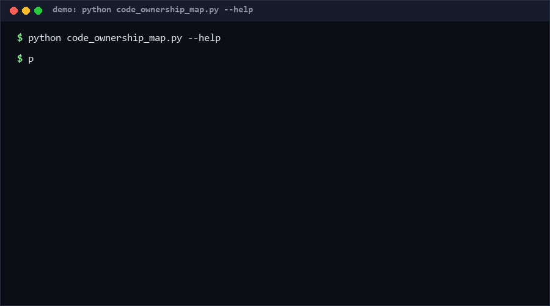

# code-ownership-map

Turn a CODEOWNERS file and a file list into a path-by-owner map — and see where ownership is broken. Every file resolves to its owners (GitHub last-match-wins semantics); the report shows coverage, orphan paths, per-owner load, and single-owner hotspots. Two local files in, one report out: no git, no API calls. Pure Python, standard library only.

<p align="center"></p>

## Problem

CODEOWNERS is usually written once and left to rot. Nobody can answer "who owns `src/legacy/`?" without reading the file top to bottom, mentally applying last-match-wins, and hoping no pattern is shadowed. The visible symptoms — review requests bouncing, PRs waiting on a departed engineer, whole directories silently uncovered — appear only when a change lands in the wrong place. The gap between "CODEOWNERS exists" and "CODEOWNERS reflects reality" is invisible until it costs a day of review latency.

## How it works

1. **Parse** CODEOWNERS: one pattern + one or more owners (`@user`, `@org/team`, or email) per line; malformed lines are counted, never fatal.
2. **Match** with documented simplified GitHub semantics: patterns ending in `/` cover the whole subtree; anchored patterns (containing `/`) match from the repo root; bare patterns/globs (`*.md`, `Makefile`) match basenames at any level. The **last matching rule wins**, like GitHub.
3. **Map** every path from the tree file (e.g. `git ls-files` output — status-prefixed lines are filtered): resolved owners, orphans, per-owner totals, top-level directory buckets, and a path-class × owner matrix.
4. **Report** the risk view: coverage %, orphan sample (capped), single-owner file count (bus factor), `--min-coverage` CI gate (exit 1).

## Quickstart

```bash
# ~2 min total (first run: git ls-files > tree.txt)
python code_ownership_map.py map --codeowners CODEOWNERS --tree tree.txt
python code_ownership_map.py map --codeowners CODEOWNERS --tree tree.txt --json
python code_ownership_map.py map --codeowners CODEOWNERS --tree tree.txt --min-coverage 95
```

## Why not X

- **watson/codeowners-audit** — scans CODEOWNERS coverage and renders a polished interactive HTML gap report with GitHub-parity validation (ignored files, invalid owners), runnable locally or against remote repos via `npx`. It is Node-based and presentation-first; this tool is the stdlib-Python, CI-gateable risk summary.
- **dzaba1/CodeownersAudit** — a script answering "which files are tracked by CODEOWNERS" — coverage only, no owner-load or bus-factor view.
- **erikdoe/code-ownership-map** — same name, different layer: a UI for exploring ownership, not a static audit you can gate a pipeline on.
- **GitHub's own CODEOWNERS validation** — tells you a rule is syntactically live, not how much of the tree it actually covers.

## How this differs from codeowners-audit

The closest anchor, `watson/codeowners-audit`, per its README generates "a polished, interactive HTML report for CODEOWNERS coverage, ownership gaps, and GitHub-parity validation" and can fail CI "when files are uncovered". It is the discovery-and-presentation layer: drill-down UI, live examples on large repos, remote-repo scanning via npx. This repo is the risk-analysis layer beneath that: coverage is the *input*, not the product — the output adds per-owner load distribution, single-owner (bus-factor) hotspots, a directory × owner matrix, and a numeric coverage gate. Where the anchor asks "which files have no matching owner rule?", this asks "which owners and directories are one resignation away from unowned?". They compose: the anchor's HTML drill-down for humans, this report's JSON for dashboards and CI.

## Performance

[Measured] on Windows 10 Pro, Python 3.11, 2026-10-13. A 10,000-file tree maps in **40.0 ms per run** (0.800 s for 20 runs). Reproduce:

```bash
python -c "import time,code_ownership_map as m; rules,_=m.parse_codeowners('*.py @a\n/src/ @b @c\n/docs/ @d\n'); paths=[('src/f%d.py'%i if i%2 else 'docs/f%d.md'%i) for i in range(10000)]; t0=time.perf_counter(); [m.build_map(rules,paths) for _ in range(20)]; print((time.perf_counter()-t0)*50)"
```

## Minimal Fallback

No Python? `git ls-files | wc -l` is your file count; `grep -c . CODEOWNERS` your rule count. For orphans, run `git ls-files | grep -vFf <(awk 'NF>1{print $1}' CODEOWNERS)` — crude but surfaces uncovered prefixes. Single-owner hotspots need the mapping logic, which is where the spreadsheet approach breaks down; that gap is the tool's reason to exist.

## Design Trade-offs

- **File list over `git ls-files` invocation** — the tool never shells out to git; you bring the tree, so it works on exported snapshots and CI tarballs with git absent.
- **Simplified matching semantics** — GitHub's real rules depend on CODEOWNERS file location (root vs `.github/`); this tool documents one deterministic interpretation rather than emulating all of them.
- **Risk view over HTML polish** — a JSON/text report is composable; pretty drill-downs are the anchor's job.
- **Owners counted per file, not per line** — a file with 2 owners counts once for coverage but twice in the per-owner load, which is the honest way to measure review burden.

## Limits & Second-order Effects

- CODEOWNERS owners are not verified against actual review activity; an org can be 100% "covered" by a team that never reviews.
- Bus-factor counting treats all files equally — a single-owner 3-line script and a single-owner core module score the same.
- If `--min-coverage` gates CI, teams will add `* @everyone` rules to pass, which destroys routing signal while keeping coverage at 100%.
- Simplified matching can diverge from GitHub on exotic patterns (negations, escaped spaces); the tool flags nothing there.

## FAQ

**When NOT to use this?**
When you need GitHub-parity validation of *rule syntax* (ignored files, oversized repos) or an interactive drill-down — use watson/codeowners-audit. Also skip it if your review-activity data, not CODEOWNERS, is the source of truth you trust.

**Why last-match-wins?**
It is GitHub's documented resolution order; replicating it keeps this report consistent with what GitHub actually routes.

**Does it verify that owners exist?**
No — syntactic validation only (`@token` or email). Live team lookup needs API access, which is intentionally out of scope.

**What's a "single-owner file"?**
A file whose winning rule names exactly one owner. Many of those = bus-factor risk.

## Core Assumptions

- [A1] CODEOWNERS last-match-wins semantics are the ownership contract teams care about. Confidence: High.
- [A2] A file list from `git ls-files` (or equivalent) accurately represents the tree. Confidence: High.
- [A3] Owner-load distribution and single-owner counts are decision-relevant risk metrics. Confidence: Medium — orgs weigh them differently.
- [A4] Two-file input (CODEOWNERS + tree) is available in any repo or CI snapshot. Confidence: High.

Confidence in the mapping mechanism: High. As of 2026-10-13.

## License

MIT — see [LICENSE](LICENSE). Contact: hcac4735@agent.qq.com

---

Part of the [zhengming-toolbox](https://github.com/chenhz01/zhengming-toolbox) — 105 purpose-built AI-engineering tools across neglected niches.

Related tools: [health-endpoint-spec](https://github.com/chenhz01/health-endpoint-spec) · [latency-budget-spec](https://github.com/chenhz01/latency-budget-spec) · [free-tier-exhaustion-predictor](https://github.com/chenhz01/free-tier-exhaustion-predictor)
